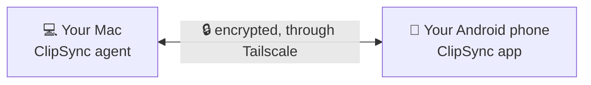

# ClipSync

**Copy on your Mac, paste on your Android phone. Copy on your phone, paste on your Mac.**

ClipSync keeps the clipboards of your Mac and your Android phone in sync. Copy a link, an address, a code or a whole paragraph on one device, and a moment later you can paste it on the other.

- **Mac → phone is automatic.** Copy something on your Mac, then paste it on your phone. That's all.
- **Phone → Mac takes one tap**, or no tap at all with the optional [automatic mode](#step-6-optional-make-phone--mac-automatic).
- **Private.** Your text goes straight from one of your devices to the other, locked with a key that only those two devices have. There's no ClipSync server or cloud, no ClipSync account, no ads and no tracking.
- **Works anywhere:** at home, at work or on mobile data, thanks to the free app [Tailscale](https://tailscale.com).
- **Free and open source.**

ClipSync syncs **text**: words, links, addresses, phone numbers and codes. It doesn't sync pictures or files.

## Contents

- [What you need](#what-you-need)
- [How it works](#how-it-works)
- [Setup, step by step](#setup-step-by-step) (about 15 minutes, only once)
  1. [Install Tailscale on both devices](#step-1-install-tailscale-on-both-devices)
  2. [Install ClipSync on your Mac](#step-2-install-clipsync-on-your-mac)
  3. [Install the ClipSync app on your phone](#step-3-install-the-clipsync-app-on-your-phone)
  4. [Pair your phone with your Mac](#step-4-pair-your-phone-with-your-mac)
  5. [Keep ClipSync running on your phone](#step-5-keep-clipsync-running-on-your-phone)
  6. [Optional: make phone → Mac automatic](#step-6-optional-make-phone--mac-automatic)
- [Everyday use](#everyday-use)
- [Settings](#settings)
- [Privacy and security](#privacy-and-security)
- [Troubleshooting](#troubleshooting)
- [Questions and answers](#questions-and-answers)
- [Updating](#updating)
- [Uninstalling](#uninstalling)
- [For developers](#for-developers)

## What you need

| | What you need | Good to know |
|---|---|---|
| 💻 | **A Mac** with macOS 12 Monterey or newer | Both Apple Silicon and Intel Macs work. To check your version, open the Apple menu (top-left corner of the screen) and choose **About This Mac**. |
| 📱 | **An Android phone** with Android 10 or newer | Any brand works: Samsung, Google Pixel, Xiaomi, OnePlus, Motorola and others. To check your version, open **Settings → About phone** (on Samsung, then **Software information**). |
| 🔒 | **Tailscale** on both devices | A free app that gives your devices a private, encrypted connection to each other. [Step 1](#step-1-install-tailscale-on-both-devices) shows how to set it up. |
| 🎩 | **Alfred with the Powerpack** *(optional)* | [Alfred](https://www.alfredapp.com) is a popular Mac launcher app. The [Powerpack](https://www.alfredapp.com/powerpack/) is its paid upgrade. With it, ClipSync adds a handy `clip` menu and a keyboard shortcut. Without it, ClipSync works just as well: you type a few short commands in Terminal instead, and you can copy and paste them from this page. |
| ⚡ | **Shizuku** *(optional)* | A free Android app. You only need it if you want phone → Mac to work without tapping. |

Both devices need to be online (on any Wi-Fi or on mobile data) to sync.

## How it works



- **On your Mac**, a small helper runs in the background. It has no window; this guide calls it the *agent*.
  - When you copy text, the agent sends it to your phone.
  - When text arrives from your phone, the agent puts it on your Mac's clipboard, ready to paste with **⌘V**.
- **On your phone**, the ClipSync app stays connected to your Mac. Text from your Mac goes straight onto the phone's clipboard, ready to paste.
- **Why does sending from the phone take a tap?** Since Android 10, apps aren't allowed to read your clipboard while you're using another app. This stops apps from spying on what you copy.
  - ClipSync follows that rule. It reads your clipboard only when you tap **Send to Mac**, which you'll find in several handy places.
  - If you'd rather not tap at all, [Step 6](#step-6-optional-make-phone--mac-automatic) turns on automatic mode with the help of Shizuku.
- **Why Tailscale?** Tailscale connects your own devices through an encrypted tunnel. It works whether they're on the same Wi-Fi, on different networks or on mobile data.
  - ClipSync talks *only* through that tunnel.
  - It never uses your ordinary Wi-Fi network directly, so other devices on that network can't even reach it.

<details>
<summary><b>Words used in this guide</b> (click to open)</summary>

| Word | Meaning |
|---|---|
| **Clipboard** | Where your device keeps what you copied, until you paste it. |
| **Tailscale** | A free app that links your own devices through a private, encrypted network. |
| **Pairing** | Introducing your phone and your Mac to each other, once, by scanning a QR code. It creates a secret key that only these two devices know. |
| **Agent** | The ClipSync helper that runs in the background on your Mac. |
| **Alfred** | A Mac app for opening apps and running commands from the keyboard. ClipSync adds a `clip` command to it. |
| **Terminal** | The Mac app for typing commands. To open it, press **⌘ Command + Space**, type `Terminal` and press **Return**. |
| **Quick Settings** | The panel of buttons (Wi-Fi, Bluetooth, flashlight and so on) that appears when you swipe down from the top of your phone's screen. |
| **Sensitive** | A label for secrets such as passwords. Sensitive text is hidden from previews and isn't saved in clipboard history. |
| **Shizuku** | An optional Android app that lets ClipSync read the clipboard in the background, for fully automatic phone → Mac. |

</details>

## Setup, step by step

You set ClipSync up once, and after that it just runs. Setup takes about 15 minutes. Have your Mac and your phone at hand.

In short:
1. Install Tailscale on both devices.
2. Install ClipSync on both devices.
3. Scan a QR code with your phone.

### Step 1: Install Tailscale on both devices

1. **On your Mac:** download Tailscale from [tailscale.com/download](https://tailscale.com/download), open it and sign in.
   - You can sign in with a Google, Microsoft, Apple or GitHub account.
   - Tailscale is free for personal use.
2. **On your phone:** install [Tailscale from Google Play](https://play.google.com/store/apps/details?id=com.tailscale.ipn), open it and sign in **with the same account** you used on your Mac.
3. Allow the permissions Tailscale asks for during setup, such as adding a VPN configuration. It needs them to connect your devices.
4. Check that Tailscale says **Connected** on both devices.
   - On your Mac, click the Tailscale icon in the menu bar at the top of the screen.
   - On your phone, open the Tailscale app.

> [!TIP]
> Leave Tailscale on. If it's off, ClipSync simply waits. It reconnects by itself as soon as Tailscale is back.

### Step 2: Install ClipSync on your Mac

Choose **A** if you have Alfred with the Powerpack, or **B** if you don't.

#### A. With Alfred

1. Download **ClipSync.alfredworkflow** from the [latest release](../../releases/latest).
2. Double-click the downloaded file. Alfred shows the workflow and its settings. You can leave the settings as they are; click **Import**.
3. Open Alfred (usually with **⌥ Option + Space**), type `clip` and choose **Start agent**.

Done. The agent now runs in the background, and starts by itself every time you log in to your Mac.

#### B. Without Alfred

1. Download **clipsync-mac.zip** from the [latest release](../../releases/latest). If your browser doesn't unzip it by itself, double-click it. You get a file called **clipsync**.
2. Drag **clipsync** into your **Applications** folder.
3. Open **Terminal**: press **⌘ Command + Space**, type `Terminal` and press **Return**.
4. Copy this line, paste it into the Terminal window and press **Return**:

   ```sh
   /Applications/clipsync start
   ```

   Terminal answers `ClipSync agent started`.

Done. The agent now runs in the background, and starts by itself every time you log in. You can close Terminal.

#### If your Mac shows a warning

ClipSync isn't signed with a paid Apple developer certificate, so the first time it runs, macOS may block it. The message says something like **“clipsync” Not Opened** or **“clipsync” cannot be opened because the developer cannot be verified**. To allow it:

1. Close the message with **Done** or **Cancel**. (Don't move it to the Trash.)
2. Open **System Settings → Privacy & Security** and scroll down to **Security**.
   - Next to the note about “clipsync”, click **Open Anyway** (or **Allow Anyway**).
   - Confirm with your password or Touch ID.
   - On macOS 12, this is in **System Preferences → Security & Privacy → General**.
3. Do the blocked step again: choose **Start agent** again, or run the Terminal command again. If macOS asks once more, click **Open** or **Open Anyway**.

Later, macOS may ask two more questions. Both are safe to allow:

- **“clipsync” wants access to control “Alfred”:** click **Allow**. ClipSync shows its notifications through Alfred.
- If macOS asks whether **clipsync** may **paste from other apps** or access the clipboard, click **Allow**. Reading the clipboard is how ClipSync sees what you copy.

### Step 3: Install the ClipSync app on your phone

ClipSync isn't on Google Play, so you download the app yourself. Android calls this installing an "unknown app" and asks you to confirm it once.

1. **On your phone**, open the [latest release](../../releases/latest) page and tap **ClipSync.apk** to download it.
   > Reading this on your Mac? Send yourself the link to this page (by email, for example) and open it on your phone.
2. When the download finishes, tap it. You'll find it in the notification, or in your **Files** app (**My Files** on Samsung) under **Downloads**.
3. If Android says your phone isn't allowed to install unknown apps from this source:
   1. Tap **Settings**.
   2. Turn on **Allow from this source**.
   3. Go back and tap **Install**.
4. Google Play Protect may say it doesn't recognize the app. That's normal for apps from outside Google Play. Follow its prompts to install anyway, for example **More details → Install anyway**.
5. Open **ClipSync**. In the **Setup** card, tap each button:
   - **Notifications → Allow.** ClipSync shows a small permanent notification with **Send clipboard** buttons. Android requires a notification for apps that stay connected in the background.
   - **Unrestricted battery → Allow.** This stops Android from cutting the connection while your phone is idle.
   - **Quick Settings tile → Add tile.** This puts a **Send to Mac** button in your Quick Settings panel.
     - On Android 10, 11 and 12 there's no **Add tile** button. Instead, swipe down from the top of the screen twice and tap the pencil (edit) icon. Then drag **Send to Mac** into your tiles.

### Step 4: Pair your phone with your Mac

Pairing introduces your phone and your Mac to each other. It creates a secret key that only these two devices know. You only do it once.

Before you start, make sure Tailscale is connected on both devices.

1. **On your Mac**, show the pairing code:
   - **With Alfred:** open Alfred, type `clip` and choose **Pair a phone**.
   - **Without Alfred:** in Terminal, run `/Applications/clipsync pair`.

   A window with a QR code opens.
2. **On your phone**, open ClipSync and tap **Pair with a Mac**, then **Scan QR code**. Point the camera at the QR code.
3. The phone asks **Pair with “*your Mac's name*”?** Check that it's your Mac, then tap **Pair**.

That's it. Within a few seconds:

- your phone shows **Connected to** *your Mac's name*,
- your Mac shows the notification **📱 Paired with** *your phone's name*,
- with Alfred, `clip` shows **🟢 Connected to** *your phone's name*.

Close the QR code window, then try it: copy something on your Mac and paste it on your phone.

> [!IMPORTANT]
> The QR code contains your secret key, so treat it like a password: don't share it, and don't take a screenshot of it. If nobody scans it, it stops working after 10 minutes. If you think someone else got hold of it, [unpair](#pairing-another-phone-or-unpairing) and pair again.

<details>
<summary><b>The scanner doesn't work?</b></summary>

- **“Scanner unavailable”:** the scanner is part of Google Play services, and the first time it may still be downloading. Wait a minute and try again.
- **Try your phone's Camera app:** point it at the QR code. Many camera apps offer to open the link. Choose ClipSync.
- **Paste the link instead:**
  1. On your Mac, run `/Applications/clipsync pair-link` in Terminal (with Alfred, see [Terminal commands](#terminal-commands)). It shows the pairing link.
  2. Get the link onto your phone. It contains your secret key, so only send it in a way you trust.
  3. Paste it into the **Or paste the pairing link** box in ClipSync.

Phones without Google Play services, such as recent Huawei phones, can't use the built-in scanner. Use the Camera app or the link instead.

</details>

### Step 5: Keep ClipSync running on your phone

To save battery, Android phones put apps that run in the background to sleep. If that happens to ClipSync or to Tailscale, clips from your Mac stop arriving until you open the app again.

To prevent it, let **both ClipSync and Tailscale** run in the background without limits. The **Keep it running in the background** card in the ClipSync app shows these steps too.

**Samsung**

1. Open **Settings → Apps → ClipSync → Battery** and choose **Unrestricted**. Do the same for **Tailscale**.
2. Open **Settings → Battery → Background usage limits**. On older phones, this is **Settings → Battery and device care → Battery → Background usage limits**.
3. Tap **Never sleeping apps** and add **ClipSync** and **Tailscale**.

**Google Pixel and most other phones**

Open **Settings → Apps → Tailscale → App battery usage** (or **Battery**) and choose **Unrestricted**. ClipSync's **Unrestricted battery** button in Step 3 already did this for ClipSync.

**Xiaomi, OnePlus, Huawei, Honor, Oppo, Vivo and some others**

These phones have extra limits of their own. Look up your phone's brand on [dontkillmyapp.com](https://dontkillmyapp.com) and follow its steps for both apps. The **Open dontkillmyapp.com** button in the ClipSync app takes you straight to your brand's page.

### Step 6 (optional): Make phone → Mac automatic

Normally you tap **Send to Mac** to send something from your phone (see [Everyday use](#from-your-phone-to-your-mac)). If you'd like everything you copy on your phone to reach your Mac on its own, ClipSync can do that with the help of **Shizuku**. Shizuku is a free app that gives ClipSync the special permission it needs to read the clipboard in the background.

This is **off** unless you turn it on, and you don't need it to use ClipSync. Good to know before you start:

- Shizuku starts through **Wireless debugging**, a feature in Android's hidden **Developer options** menu. You turn that menu on once.
  - A few banking and payment apps refuse to open while Developer options are on.
- You need Wi-Fi to start Shizuku. After it has started, it keeps running on mobile data too.
- After your phone restarts, you start Shizuku again with two taps. Until you do, the one-tap ways to send still work.

**Set up Shizuku (once)**

1. Install [Shizuku from Google Play](https://play.google.com/store/apps/details?id=moe.shizuku.privileged.api).
2. Turn on Developer options:
   1. Open **Settings → About phone**. On Samsung, also tap **Software information**.
   2. Tap **Build number** seven times, and enter your PIN if asked.
   3. Android says “You are now a developer”.
3. Connect to Wi-Fi, open **Shizuku** and tap **Pairing** under **Start via Wireless debugging**. Then follow Shizuku's instructions:
   1. Open **Settings → Developer options → Wireless debugging** and turn it on.
   2. Tap **Pair device with pairing code**.
   3. Type the code you see into Shizuku's notification.
4. Go back to Shizuku and tap **Start**. Shizuku now says **Shizuku is running**.

Shizuku's own [setup guide](https://shizuku.rikka.app/guide/setup/) shows these steps with pictures. It also explains Android 10, where you start Shizuku from a computer instead.

**Turn on automatic sending**

1. Open ClipSync and switch on **Automatic phone → Mac**.
2. If it says **ClipSync needs permission in Shizuku**, tap **Grant Shizuku access** and choose **Allow**.
3. It shows **✓ On: watching the clipboard**. From now on, everything you copy on your phone goes to your Mac.

**After your phone restarts:** open Shizuku and tap **Start**. If Shizuku asks, turn **Wireless debugging** back on first. ClipSync notices by itself.

Even in automatic mode, ClipSync doesn't send:

- passwords and anything else your password manager marks as sensitive,
- text that just arrived from your Mac, so nothing bounces back and forth,
- the same text again if you copy it twice within 10 minutes.

To stop automatic sending, switch it off in ClipSync. To take away ClipSync's access completely, open Shizuku and turn ClipSync off in its list of apps.

## Everyday use

### From your Mac to your phone

Copy as usual: **⌘C**, or **Edit → Copy**. A moment later, paste it on your phone: touch and hold a text field and tap **Paste**.

ClipSync **doesn't** send these automatically, on purpose:

- passwords and other items that password managers mark as secret,
- anything you copy while a password app is in front, such as 1Password, Bitwarden, KeePassXC, Apple Passwords or Keychain Access. You can change this list in [Settings](#on-your-mac).
- text larger than 1 MB, which is about 500 pages,
- pictures and files.

To send a password, or something you copied in a password app, send it by hand:
- **With Alfred:** `clip` → **Send clipboard to phone**.
- **Without Alfred:** in Terminal, run `/Applications/clipsync send`.

It arrives on your phone marked as [sensitive](#passwords-and-other-secrets).

**Pausing.** To stop sending your Mac copies for a while, choose `clip` → **Pause auto-sync**. To start again, choose **Resume auto-sync**. In Terminal, use `/Applications/clipsync pause` and `/Applications/clipsync resume`. While paused, text from your phone still arrives.

### From your phone to your Mac

Copy the text on your phone, then send it in any of these ways:

| Where | How |
|---|---|
| **Quick Settings** | Swipe down from the top of the screen (twice on most phones) and tap the **Send to Mac** tile. |
| **Notification** | Swipe down, then tap **Send clipboard** on the ClipSync notification. |
| **Share button** | In any app, tap **Share** and choose **Send to Mac**. This sends what you're sharing, so you don't need to copy it first. |
| **Selected text** | Select some text, then tap **Send to Mac** in the menu that pops up. If you don't see it, tap **⋮** or **›** for more options. No need to copy first. |
| **App icon** | Touch and hold the ClipSync icon and tap **Send clipboard**. |
| **ClipSync app** | Open ClipSync and tap **Send clipboard now**. |
| **Automatic** | With [automatic mode](#step-6-optional-make-phone--mac-automatic) on, everything you copy is sent by itself. |

On your Mac, the text is now on the clipboard: press **⌘V** to paste it.
- A notification shows what arrived (**📋 From** *your phone's name*). You can turn these notifications off in [Settings](#on-your-mac).
- If you use Alfred's Clipboard History, the text shows up there too, unless it was sent as sensitive.

**Copied something else since then?** In Alfred, type `clip` and choose **Last from** *your phone's name*. Press **Return** to copy it again, or **⌘ Return** to paste it straight into the app in front. In Terminal, `/Applications/clipsync last` copies it again.

After you send, the phone shows a short message:

| Message | What it means |
|---|---|
| **Sent to Mac** | Done. |
| **Already on your Mac** | That exact text just came from your Mac, so it wasn't sent back. |
| **Mac not reachable — will keep trying for 5 minutes** | Your Mac is asleep, offline or not connected to Tailscale. ClipSync delivers the text if your Mac comes back within 5 minutes. |
| **Couldn't reach your Mac — clip dropped** | Only the newest clip waits for your Mac, so this older one was dropped. |
| **Clipboard is empty or not text** | There's nothing to send, or it's a picture. |
| **Too large to send (max 1 MB)** | The text is too long for ClipSync. |
| **ClipSync isn't paired with a Mac yet** | Do [Step 4](#step-4-pair-your-phone-with-your-mac) first. |

### Passwords and other secrets

ClipSync can mark text as **sensitive**. Use this for passwords, codes and other secrets.

- **From your phone**, choose **Send as sensitive** on the notification, or **Send to Mac (sensitive)** in the Share menu.
  - Your Mac marks the text as secret, so clipboard history apps, including Alfred's, don't save it.
  - The notification shows `••••••` instead of the text.
- **From your Mac**, items your password manager marks as secret are never sent automatically.
  - If you send one by hand, it arrives on your phone as sensitive.
  - Android 13 and newer then hide it from the clipboard preview.

### The Alfred menu

Type `clip` in Alfred to see:

| Item | What it does |
|---|---|
| 🟢 / 🟡 / 🔴 status line | Whether the agent is running and your phone is connected. [Troubleshooting](#what-the-status-messages-mean) explains each message. |
| **Send clipboard to phone** | Sends what's on your Mac's clipboard right now, even while auto-sync is paused. |
| **Last from** *phone* | Copies the last text that came from your phone. **⌘ Return** pastes it. |
| **Pause auto-sync** / **Resume auto-sync** | Stops or restarts automatic sending of what you copy on your Mac. |
| **Pair a phone** | Shows a new pairing QR code. |
| **Show pairing QR code** | Shows the code again while a pairing is in progress. |
| **Unpair** *phone* | Makes your Mac forget that phone. |
| **Start agent** / **Stop agent** | Starts or stops ClipSync on your Mac. After **Stop agent**, it doesn't start at login either. |
| **Show log** | Opens ClipSync's log, which helps when something goes wrong. |

Two more Alfred extras:

- **Keyboard shortcut.** You can give "send clipboard to phone" its own shortcut:
  1. Open Alfred Preferences → **Workflows → ClipSync**.
  2. Double-click the **Hotkey** box.
  3. Press the keys you want and click **Save**.
- **Universal Action.** Select text in any app and press Alfred's Universal Actions shortcut (`⌥⌘\` unless you changed it). Then choose **Send to phone clipboard**. This also works on entries in Alfred's Clipboard History.

### Terminal commands

Without Alfred, these commands do everything the `clip` menu does. Copy a line into Terminal and press **Return**.

| Command | What it does |
|---|---|
| `/Applications/clipsync status` | Shows whether the agent is running and which phone is connected. |
| `/Applications/clipsync send` | Sends your Mac's clipboard to your phone now. |
| `/Applications/clipsync send --text "Hello"` | Sends the text between the quotes. |
| `/Applications/clipsync last` | Copies the last text that came from your phone. |
| `/Applications/clipsync pause` | Pauses automatic sending of what you copy on your Mac. |
| `/Applications/clipsync resume` | Turns automatic sending back on. |
| `/Applications/clipsync pair` | Shows a new pairing QR code. |
| `/Applications/clipsync pair-link` | Shows the pairing link, to paste into the app instead of scanning. |
| `/Applications/clipsync unpair` | Forgets all paired phones. |
| `/Applications/clipsync start` | Starts the agent. It then also starts at every login. |
| `/Applications/clipsync stop` | Stops the agent. It no longer starts at login. |

> [!NOTE]
> Using Alfred and want these commands too? After **Start agent**, a copy of `clipsync` lives in ClipSync's data folder. Use it in place of `/Applications/clipsync`, including the quotes:
> `"$HOME/Library/Application Support/Alfred/Workflow Data/com.clipsync.alfred/bin/clipsync"`

### Pairing another phone, or unpairing

- **New phone, or pairing again:** repeat [Step 4](#step-4-pair-your-phone-with-your-mac). On a phone that's already paired, tap **Re-pair** in the **Pairing** card.
- **Several phones:** you can pair more than one phone with your Mac. Mac copies go to every connected phone. Each phone pairs with one Mac at a time.
- **Unpair:** do both of these to remove the key from both devices.
  - **On your Mac:** `clip` → **Unpair** *phone*, or in Terminal, `/Applications/clipsync unpair`.
  - **On your phone:** open ClipSync → **Unpair**.

## Settings

### On your Mac

Open Alfred Preferences → **Workflows** → **ClipSync**, and click **Configure Workflow…** at the top right.

| Setting | Normally | What it does |
|---|---|---|
| **Keyword** | `clip` | What you type in Alfred to open the ClipSync menu. |
| **Notifications** | On | Shows a notification for each text that arrives from your phone. |
| **Port** | `48613` | The connection “door” ClipSync uses on your Mac. Only change it if another app already uses this number. Pair your phone again afterwards. |
| **Max clip size** | `1024` (KB) | Copies larger than this aren't sent automatically. 1024 KB (1 MB) is also the most ClipSync can send. |
| **Ignored apps** | 1Password, Bitwarden, KeePassXC, Apple Passwords, Keychain Access | Copies made while one of these apps is in front are never sent automatically. To add an app, add its ID to the list, separated by a comma. |

To find an app's ID, run this in Terminal, with the app's name in place of Notes:

```sh
osascript -e 'id of app "Notes"'
```

Without Alfred, ClipSync uses the normal settings shown above. You can still pause and resume with the [Terminal commands](#terminal-commands).

### On your phone

The ClipSync app has:

- **Automatic phone → Mac:** the switch from [Step 6](#step-6-optional-make-phone--mac-automatic). It's off unless you turn it on.
- **Send clipboard now.**
- **Reconnect:** tries to reach your Mac right away instead of waiting for the next retry.
- **Re-pair** and **Unpair**, in the **Pairing** card, which also shows your Mac's Tailscale address.

The ClipSync notification has to stay while the app is connected. To make it less noticeable, touch and hold it and choose **Silent**. It's best not to turn it off completely, because its buttons are a quick way to send.

## Privacy and security

In short: **only your two devices can read your clips, and they never pass through anyone's server in a readable form.**

- **Locked twice.** Tailscale encrypts the connection between your devices. On top of that, ClipSync encrypts every clip with the secret key it created when you paired. Even another device on your own Tailscale network can't read your clips, or send you any, without that key.
- **Never over ordinary Wi-Fi.**
  - Your Mac only accepts connections that come through Tailscale.
  - Your phone only connects through Tailscale.
  - If Tailscale is off, ClipSync waits. It never falls back to Wi-Fi.
- **No cloud, no tracking.** ClipSync has no server and no account. It doesn't collect statistics and doesn't show ads. The QR scanner in the phone app is provided by Google Play services, and runs only while you scan.
- **Passwords stay put.** Items that password managers mark as secret are never sent automatically. Neither is anything you copy while a password app is in front.
- **No history.** ClipSync doesn't keep a history of what you copy.
  - A clip waiting to be delivered is kept in memory for at most 5 minutes.
  - Your Mac remembers the last text from your phone (for **Last from …**) until the agent restarts.
  - Logs never contain the text you copied.
- **Only the key is stored.**
  - On your Mac, it's in a file that only your user account can read.
  - On your phone, it's protected by Android's secure key storage and is never included in backups.
- **Automatic mode** only reads the clipboard, and only while its switch is on. You can take away its access in the Shizuku app at any time.
- **Open source.** Anyone can check the code. The technical details are below.

<details>
<summary><b>Technical details</b></summary>

- **Pairing:** creates a random 256-bit key and a pairing ID, which the QR code carries once.
- **Session keys:** each connection derives fresh keys with HKDF-SHA256, from that key and random values from both sides. Each side proves it holds the key before any clip is exchanged.
- **Encryption:** every message is encrypted and authenticated with AES-256-GCM. A per-direction counter rejects replayed, reordered or missing messages.
- **Mac network rules:** the agent listens only on the Mac's Tailscale address (100.64.0.0/10). It rejects peers from other addresses, and connections that arrive on a Wi-Fi or Ethernet interface.
- **Phone network rules:** the app binds its connection to the Tailscale VPN network. It doesn't request Android's local-network permission.
- **Key storage:**
  - Mac: in `~/Library/Application Support/Alfred/Workflow Data/com.clipsync.alfred/config.json`, readable only by your user (mode 0600).
  - Android: wrapped with an Android Keystore key. App backups are disabled.
- **Specification:** the full protocol is in [protocol/PROTOCOL.md](protocol/PROTOCOL.md). The Mac and Android code are both tested against the same test vectors, which Node.js generates independently.

</details>

## Troubleshooting

### What the status messages mean

**On your Mac**, in Alfred's `clip` menu. In Terminal, `clipsync status` shows the same information as plain text.

| You see | What it means | What to do |
|---|---|---|
| 🟢 **Connected to** *phone* | Everything works. | Nothing. |
| 🟡 **Waiting for** *phone*… | The agent is running, but your phone isn't connected. | Check your phone (see the next table). |
| 🟡 **No phone paired yet** | You haven't paired a phone. | Do [Step 4](#step-4-pair-your-phone-with-your-mac). |
| 🔴 **Tailscale is off on this Mac** | ClipSync only works through Tailscale. | Connect Tailscale from its menu bar icon. ClipSync carries on by itself. |
| 🔴 **ClipSync agent is stopped** | The agent isn't running. | Choose **Start agent**, or run `/Applications/clipsync start`. |
| 🔴 **Can't listen on port 48613** | Another app is using ClipSync's port. | Change the **Port** in [Settings](#on-your-mac), then pair your phone again. |

**On your phone**, in the ClipSync app and its notification:

| You see | What it means | What to do |
|---|---|---|
| **Connected to** *Mac* | Everything works. | Nothing. |
| **Connecting via 100.…** | ClipSync is reaching out to your Mac. | Wait a few seconds. |
| **Mac not reachable — retrying** | Your Mac can't be reached right now. | Check these, then tap **Reconnect**:<br>1. Your Mac is on and awake.<br>2. Tailscale is connected on both devices, with the same account.<br>3. The agent is running on your Mac. |
| **Last error: Tailscale isn't connected on this phone** | Tailscale is off on your phone. | Open Tailscale and connect. |
| **Re-pair needed — open ClipSync** | Your Mac no longer knows this phone. For example, it was unpaired, or the pairing wasn't finished within 10 minutes. | Tap **Re-pair** and scan a new code. |
| **Not paired with a Mac** | You haven't paired yet. | Do [Step 4](#step-4-pair-your-phone-with-your-mac). |

### Common problems

**Clips from my Mac stop arriving after a while, or only arrive when I open the app.**
Your phone is putting ClipSync or Tailscale to sleep. Go through [Step 5](#step-5-keep-clipsync-running-on-your-phone) for **both** apps.

**I copied something on my Mac, but it didn't reach my phone.**
- Is auto-sync paused? If it is, the `clip` menu shows **Resume auto-sync**.
- Was it a password, or did you copy it while a password app was in front? ClipSync skips those on purpose; [send it by hand](#from-your-mac-to-your-phone).
- Was it a picture or a file? ClipSync only syncs text.
- Is your phone connected (🟢)?

**I tapped Send to Mac, but nothing arrived.**
Look at the message the phone showed, and check [what it means](#from-your-phone-to-your-mac).

**macOS says “clipsync” can't be opened.**
See [If your Mac shows a warning](#if-your-mac-shows-a-warning).

**There are no notifications on my Mac.**
- **With Alfred:**
  - Check that **Notifications** is on in the [workflow settings](#on-your-mac).
  - Check that Alfred is allowed to show notifications, in **System Settings → Notifications → Alfred**.
  - If you clicked **Don't Allow** when macOS asked whether clipsync may control Alfred, turn it back on in **System Settings → Privacy & Security → Automation**.
- **Without Alfred:** macOS shows ClipSync's notifications on behalf of **Script Editor**. Check that Script Editor is allowed to show notifications, in **System Settings → Notifications**.

**While pairing, the phone says “This code has no Tailscale address”, or the Mac says “Tailscale isn't connected on this Mac”.**
Tailscale was off on your Mac. Connect it, then choose **Pair a phone** again.

**The Send to Mac tile is missing.**
Add it as described at the end of [Step 3](#step-3-install-the-clipsync-app-on-your-phone).

**“Send to Mac” isn't in the text-selection menu.**
Tap **⋮** or **›** in that menu to see more options. Some apps use their own menu; in those, use **Share** or the tile.

**The ClipSync notification disappeared.**
On Android 14 and newer, you can swipe it away. ClipSync keeps working, and the notification comes back when the connection changes.

**Automatic mode says “Shizuku isn't running”.**
Your phone has restarted. Open Shizuku and tap **Start**. If Shizuku asks, turn on **Wireless debugging** first.

**Automatic mode says “ClipSync needs permission in Shizuku”.**
Tap **Grant Shizuku access** and choose **Allow**.

### Still stuck?

1. Look at the Mac's log: choose `clip` → **Show log**.
   - Without Alfred: in Finder, choose **Go → Go to Folder…** and paste `~/Library/Application Support/Alfred/Workflow Data/com.clipsync.alfred`, then open **agent.log**.
   - The log never contains the text you copied. It does show device names and Tailscale addresses.
2. [Open an issue](../../issues) on GitHub and describe what you see. Include:
   - your macOS version,
   - your Android version,
   - your phone's brand.

## Questions and answers

**Does it cost anything?**
ClipSync is free. Tailscale is free for personal use. Alfred's Powerpack is paid, but you don't need it.

**Does it work with an iPhone, or with Windows or Linux?**
No. ClipSync connects a Mac with an Android phone.

**Can it sync pictures or files?**
No, only text.

**Do my clips go through the internet?**
They go from one device to the other through Tailscale.
- When your devices can reach each other directly, the connection is direct.
- When they can't (on some mobile networks, for example), Tailscale passes the encrypted data through one of its relay servers, which can't read it.
- ClipSync has no server of its own.

**Does it work when I'm away from home?**
Yes, anywhere both devices are online with Tailscale connected, including on mobile data.

**Why not just use my Wi-Fi network?**
Every device on a Wi-Fi network can try to reach your Mac. Going only through Tailscale means that only your own devices can. That's why ClipSync never falls back to Wi-Fi.

**What if my Mac is asleep or switched off?**
Your phone holds on to the clip you just sent for 5 minutes, and delivers it if your Mac comes back in time. Your Mac does the same for your phone. After 5 minutes, the clip is dropped. Only the newest clip waits.

**Will it drain my phone's battery?**
ClipSync keeps one small, mostly quiet connection to your Mac open, a bit like a chat app does. Tailscale needs some battery too.

**Can someone else on my Tailscale network read my clips?**
No. They'd also need the secret key that only your paired devices have.

**Is ClipSync on Google Play?**
Not at the moment. Download it from the [Releases page](../../releases/latest).

## Updating

When a new version comes out on the [Releases page](../../releases/latest):

**On your Mac**

- **With Alfred:**
  1. Download the new **ClipSync.alfredworkflow** and double-click it. Alfred updates the workflow and keeps your settings.
  2. Type `clip` and choose **Stop agent**.
  3. Type `clip` again and choose **Start agent**. The agent now runs the new version.
- **Without Alfred:**
  1. Replace **clipsync** in your Applications folder with the new one.
  2. Run `/Applications/clipsync start`. The agent restarts with the new version.

macOS may show [the warning from Step 2](#if-your-mac-shows-a-warning) again for the new version.

**On your phone**

Download the new **ClipSync.apk** and install it the same way as in [Step 3](#step-3-install-the-clipsync-app-on-your-phone). It installs over the old version and keeps your pairing.

## Uninstalling

**On your Mac**

1. Stop the agent: choose `clip` → **Stop agent**, or run `/Applications/clipsync stop`. It no longer starts at login.
2. Remove ClipSync:
   - **With Alfred:** in Alfred Preferences → **Workflows**, right-click **ClipSync** and choose **Delete**.
   - **Without Alfred:** move `clipsync` from your Applications folder to the Trash.
3. Remove ClipSync's data folder, which holds the pairing key and the log:
   1. In Finder, choose **Go → Go to Folder…**.
   2. Paste `~/Library/Application Support/Alfred/Workflow Data` and press **Return**.
   3. Move the **com.clipsync.alfred** folder to the Trash.

**On your phone**

Touch and hold the ClipSync icon and choose **Uninstall** (or **App info → Uninstall**).

If you installed Shizuku only for ClipSync, you can uninstall it too. You can also turn off **Developer options** at the top of the Developer options screen.

## For developers

ClipSync has four parts:

| Folder | What it is | Built with |
|---|---|---|
| `mac/` | The `clipsync` agent and command-line tool | Swift, no third-party dependencies |
| `android/` | The Android app | Kotlin and Jetpack Compose |
| `workflow/` | The Alfred workflow | Alfred 5 |
| `protocol/` | The wire protocol (`PROTOCOL.md`) and shared test vectors | Node.js, to regenerate the vectors |

```sh
make test       # all unit tests (Swift and Kotlin; both check protocol/vectors.json)
make package    # dist/ClipSync.alfredworkflow, with a universal Mac binary inside
make android    # debug APK
```

[docs/DEVELOPMENT.md](docs/DEVELOPMENT.md) covers building, testing without a phone, and how the pieces fit together.

## License

ClipSync is released under the [MIT License](LICENSE).
