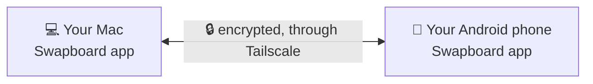

# Swapboard guide

Everything about Swapboard in one place. For the short version, see the [README](../README.md).

Swapboard keeps the clipboards of your Mac and your Android phone in sync. Copy a link, an address, a code or a whole paragraph on one device, and a moment later you can paste it on the other.

- **Mac → phone is automatic.** Copy something on your Mac, then paste it on your phone. That's all.
- **Phone → Mac takes one tap**, or no tap at all with the optional [automatic mode](#optional-make-phone--mac-automatic).
- **Easy to set up.** Install Swapboard on both devices and follow the screens. No Terminal, no settings files.
- **Private.** Your text goes straight from one of your devices to the other, locked with a key that only those two devices have. There's no Swapboard server or cloud, no Swapboard account, no ads and no tracking.
- **Works anywhere:** at home, at work or on mobile data, thanks to the free app [Tailscale](https://tailscale.com).
- **Free and open source.**

Swapboard syncs **text**: words, links, addresses, phone numbers and codes. It doesn't sync pictures or files.

## Contents

- [What you need](#what-you-need)
- [How it works](#how-it-works)
- [Setup](#setup) (about 10 minutes, only once)
- [Everyday use](#everyday-use)
- [Settings](#settings)
- [Extras for Alfred users](#extras-for-alfred-users)
- [Privacy and security](#privacy-and-security)
- [Troubleshooting](#troubleshooting)
- [Questions and answers](#questions-and-answers)
- [Updating](#updating)
- [Uninstalling](#uninstalling)
- [For developers](#for-developers)

## What you need

| | What you need | Good to know |
|---|---|---|
| 💻 | **A Mac** with macOS 12 Monterey or newer | Both Apple Silicon and Intel Macs work. To check your version, open the Apple menu (top-left corner of the screen) and choose **About This Mac**. |
| 📱 | **An Android phone** with Android 10 or newer | Any brand works: Samsung, Google Pixel, Xiaomi, OnePlus, Motorola and others. To check your version, open **Settings → About phone** (on Samsung, then **Software information**). |
| 🔒 | **Tailscale** on both devices | A free app that gives your devices a private, encrypted connection to each other. You don't need to set it up in advance: Swapboard walks you through it. |

That's all. Two optional extras:

- [**Alfred**](https://www.alfredapp.com) with the Powerpack (paid), if you already use it: Swapboard adds a `clip` command to it. See [Extras for Alfred users](#extras-for-alfred-users).
- **Shizuku**, a free Android app, if you want phone → Mac to work without tapping. See [automatic mode](#optional-make-phone--mac-automatic).

## How it works



- **On your Mac**, Swapboard lives in the menu bar at the top of the screen (look for **⇄**) and starts by itself when you log in.
  - When you copy text, it sends the text to your phone.
  - When text arrives from your phone, it puts it on your Mac's clipboard, ready to paste with **⌘V**.
- **On your phone**, the Swapboard app stays connected to your Mac. Text from your Mac goes straight onto the phone's clipboard, ready to paste.
- **Why does sending from the phone take a tap?** Since Android 10, apps aren't allowed to read your clipboard while you're using another app. This stops apps from spying on what you copy.
  - Swapboard follows that rule. It reads your clipboard only when you tap **Send to Mac**, which you'll find in several handy places.
  - If you'd rather not tap at all, you can turn on [automatic mode](#optional-make-phone--mac-automatic).
- **Why Tailscale?** Tailscale connects your own devices through an encrypted tunnel. It works whether they're on the same Wi-Fi, on different networks or on mobile data.
  - Swapboard talks *only* through that tunnel.
  - It never uses your ordinary Wi-Fi network directly, so other devices on that network can't even reach it.

## Setup

Setup takes about 10 minutes, and you only do it once. Have your Mac and your phone at hand.

### Step 1: On your Mac

1. Download **Swapboard-mac.zip** from the [latest release](../../../releases/latest).
   - Safari unzips it for you. With another browser, double-click the zip.
   - You get an app called **Swapboard**.
2. Open **Swapboard** (double-click it).
   - If macOS shows a warning, see [If your Mac shows a warning](#if-your-mac-shows-a-warning).
   - When it asks **Move Swapboard to your Applications folder?**, click **Move to Applications**.
3. A setup window opens. Follow it:
   1. **Turn on Tailscale on this Mac.** It helps you download Tailscale and sign in. You can sign in with a Google, Microsoft, Apple or GitHub account. Tailscale is free for personal use.
   2. **Get Swapboard on your Android phone.** It shows a code for your phone. That's step 2 below.
   3. **Connect your phone.** It shows a second code, for the Swapboard app to scan.

Keep the window open and pick up your phone.

### Step 2: On your phone

1. Open the **Camera** app and point it at the code in the Mac's window. Tap the link that appears, and your phone downloads **Swapboard.apk**.
   - No link appears? Open the [latest release](../../../releases/latest) page on your phone and tap **Swapboard.apk**.
2. Tap the download to install it. Android asks you to confirm; see [If your phone shows a warning](#if-your-phone-shows-a-warning).
3. Open **Swapboard** and tap **Get started**. The app guides you through four short steps:
   1. **Connect to Tailscale.** Install Tailscale from Google Play, sign in with the **same account** as on your Mac, and turn it on.
   2. **Scan the code on your Mac.** In the Mac's window, click **My phone has the app**. Then tap **Scan code** on your phone and point it at the Mac's screen. Check the Mac's name and tap **Pair**.
   3. **Keep Swapboard running.** Tap **Allow** on each line.
   4. **Add the "Send to Mac" button** to your Quick Settings.

That's it! The Mac's window shows **Connected to** *your phone's name*. Try it: copy something on your Mac and paste it on your phone.

> [!IMPORTANT]
> The pairing code contains your secret key, so treat it like a password: don't share it, and don't take a screenshot of it. If nobody scans it, a fresh code replaces it after 10 minutes.

### If your Mac shows a warning

Swapboard isn't signed with a paid Apple developer certificate yet, so the first time you open it, macOS may block it. The message says something like **"Swapboard" Not Opened** or **"Swapboard" can't be opened because Apple cannot check it for malicious software**. To allow it:

1. Close the message with **Done** or **Cancel**. (Don't move it to the Trash.)
2. Open **System Settings → Privacy & Security** (macOS 13 or newer) and scroll down to **Security**.
   - Next to the note about "Swapboard", click **Open Anyway**.
   - Confirm with your password or Touch ID.
   - On macOS 12, this is in **System Preferences → Security & Privacy → General**.
3. Open Swapboard again. If macOS asks once more, click **Open** or **Open Anyway**.

You only do this once. Later, macOS may ask two more things. Both are safe to allow:

- **"Swapboard" would like to send you notifications:** click **Allow** to see what arrives from your phone.
- If macOS asks whether **Swapboard** may **paste from other apps** or access the clipboard, click **Allow**. Reading the clipboard is how Swapboard sees what you copy.

### If your phone shows a warning

Swapboard isn't on Google Play, so Android asks you to confirm the install:

1. If Android says your phone isn't allowed to install unknown apps from this source:
   1. Tap **Settings**.
   2. Turn on **Allow from this source**.
   3. Go back and tap **Install**.
2. If Google Play Protect says it doesn't recognize the app, that's normal for apps from outside Google Play. Follow its prompts to install anyway, for example **More details → Install anyway**.

### Keep Swapboard running on your phone

To save battery, Android phones put apps that run in the background to sleep. The app's setup already asks Android to keep **Swapboard** and **Tailscale** running. Some phone makers add extra limits of their own:

- **Samsung:** open **Settings → Battery → Background usage limits → Never sleeping apps**, and add **Swapboard** and **Tailscale**. On older phones, Battery is under **Settings → Battery and device care**.
- **Xiaomi, OnePlus, Huawei, Honor, Oppo, Vivo and others:** look up your brand on [dontkillmyapp.com](https://dontkillmyapp.com) and follow its steps for both apps. In Swapboard, **Advanced options → Open dontkillmyapp.com** takes you straight to your brand's page.

If clips from your Mac only arrive after you open the app, these settings are the fix.

### Optional: make phone → Mac automatic

Normally you tap **Send to Mac** to send something from your phone (see [Everyday use](#from-your-phone-to-your-mac)). If you'd like everything you copy on your phone to reach your Mac on its own, Swapboard can do that with the help of **Shizuku**. Shizuku is a free app that gives Swapboard the special permission it needs to read the clipboard in the background.

This is **off** unless you turn it on, and you don't need it to use Swapboard. Good to know before you start:

- Shizuku starts through **Wireless debugging**, a feature in Android's hidden **Developer options** menu. You turn that menu on once.
  - A few banking and payment apps refuse to open while Developer options are on.
- You need Wi-Fi to start Shizuku. After it has started, it keeps running on mobile data too.
- After your phone restarts, you start Shizuku again with two taps. Until you do, the one-tap ways to send still work.

**Set up Shizuku (once)**

1. Install [Shizuku from Google Play](https://play.google.com/store/apps/details?id=moe.shizuku.privileged.api).
2. Turn on Developer options:
   1. Open **Settings → About phone**. On Samsung, also tap **Software information**.
   2. Tap **Build number** seven times, and enter your PIN if asked.
   3. Android says "You are now a developer".
3. Connect to Wi-Fi, open **Shizuku** and tap **Pairing** under **Start via Wireless debugging**. Then follow Shizuku's instructions:
   1. Open **Settings → Developer options → Wireless debugging** and turn it on.
   2. Tap **Pair device with pairing code**.
   3. Type the code you see into Shizuku's notification.
4. Go back to Shizuku and tap **Start**. Shizuku now says **Shizuku is running**.

Shizuku's own [setup guide](https://shizuku.rikka.app/guide/setup/) shows these steps with pictures. It also explains Android 10, where you start Shizuku from a computer instead.

**Turn on automatic sending**

1. Open Swapboard, tap **Advanced options** and switch on **Automatic phone → Mac**.
2. If it says **Swapboard needs permission in Shizuku**, tap **Grant Shizuku access** and choose **Allow**.
3. It shows **✓ On: watching the clipboard**. From now on, everything you copy on your phone goes to your Mac.

**After your phone restarts:** open Shizuku and tap **Start**. If Shizuku asks, turn **Wireless debugging** back on first. Swapboard notices by itself.

Even in automatic mode, Swapboard doesn't send:

- passwords and anything else your password manager marks as sensitive,
- text that just arrived from your Mac, so nothing bounces back and forth,
- the same text again if you copy it twice within 10 minutes.

To stop automatic sending, switch it off in Swapboard. To take away Swapboard's access completely, open Shizuku and turn Swapboard off in its list of apps.

## Everyday use

### From your Mac to your phone

Copy as usual: **⌘C**, or **Edit → Copy**. A moment later, paste it on your phone: touch and hold a text field and tap **Paste**.

Swapboard **doesn't** send these automatically, on purpose:

- passwords and other items that password managers mark as secret,
- anything you copy while a password app is in front, such as 1Password, Bitwarden, KeePassXC, Apple Passwords or Keychain Access,
- text larger than 1 MB, which is about 500 pages,
- pictures and files.

To send a password, or something you copied in a password app, send it by hand: click **⇄** in the menu bar and choose **Send Clipboard to Phone**. It arrives on your phone marked as [sensitive](#passwords-and-other-secrets).

**Pausing.** To stop sending your Mac copies for a while, choose **Pause Auto-Sync** in the Swapboard menu. Choose **Resume Auto-Sync** to turn it back on. While paused, text from your phone still arrives.

### From your phone to your Mac

Copy the text on your phone, then send it in any of these ways:

| Where | How |
|---|---|
| **Quick Settings** | Swipe down from the top of the screen (twice on most phones) and tap the **Send to Mac** tile. |
| **Notification** | Swipe down, then tap **Send clipboard** on the Swapboard notification. |
| **Share button** | In any app, tap **Share** and choose **Send to Mac**. This sends what you're sharing, so you don't need to copy it first. |
| **Selected text** | Select some text, then tap **Send to Mac** in the menu that pops up. If you don't see it, tap **⋮** or **›** for more options. No need to copy first. |
| **App icon** | Touch and hold the Swapboard icon and tap **Send clipboard**. |
| **Swapboard app** | Open Swapboard and tap **Send clipboard now**. |
| **Automatic** | With [automatic mode](#optional-make-phone--mac-automatic) on, everything you copy is sent by itself. |

On your Mac, the text is now on the clipboard: press **⌘V** to paste it.
- A notification shows what arrived. To turn these off, choose **Notify When Text Arrives** in the Swapboard menu.
- If you use a clipboard history app, the text shows up there too, unless it was sent as sensitive.

**Copied something else since then?** Choose **Copy Last Text from** *your phone* in the Swapboard menu to put it back on your Mac's clipboard.

After you send, the phone shows a short message:

| Message | What it means |
|---|---|
| **Sent to Mac** | Done. |
| **Already on your Mac** | That exact text just came from your Mac, so it wasn't sent back. |
| **Mac not reachable — will keep trying for 5 minutes** | Your Mac is asleep, offline or not connected to Tailscale. Swapboard delivers the text if your Mac comes back within 5 minutes. |
| **Couldn't reach your Mac — clip dropped** | Only the newest clip waits for your Mac, so this older one was dropped. |
| **Clipboard is empty or not text** | There's nothing to send, or it's a picture. |
| **Too large to send (max 1 MB)** | The text is too long for Swapboard. |
| **Swapboard isn't paired with a Mac yet** | Finish the [setup](#setup) first. |

### Passwords and other secrets

Swapboard can mark text as **sensitive**. Use this for passwords, codes and other secrets.

- **From your phone**, choose **Send as sensitive** on the notification, or **Send to Mac (sensitive)** in the Share menu.
  - Your Mac marks the text as secret, so clipboard history apps don't save it.
  - The notification shows `••••••` instead of the text.
- **From your Mac**, items your password manager marks as secret are never sent automatically.
  - If you send one by hand, it arrives on your phone as sensitive.
  - Android 13 and newer then hide it from the clipboard preview.

### The Swapboard menu on your Mac

Click **⇄** in the menu bar at the top of your screen:

| Item | What it does |
|---|---|
| 🟢 / 🟡 / 🔴 status line | Whether your phone is connected. [Troubleshooting](#what-the-status-messages-mean) explains each message. |
| **Send Clipboard to Phone** | Sends what's on your Mac's clipboard right now, even while auto-sync is paused. |
| **Copy Last Text from** *phone* | Puts the last text from your phone back on your Mac's clipboard. |
| **Pause Auto-Sync** / **Resume Auto-Sync** | Stops or restarts automatic sending of what you copy on your Mac. |
| **Notify When Text Arrives** | Turns the notifications for text from your phone on or off. |
| **Open at Login** | Starts Swapboard when you log in. On unless you turn it off. |
| **Set Up a Phone…** / **Set Up Another Phone…** | Opens the setup window to connect a phone. |
| **Unpair** *phone*… | Makes your Mac forget that phone. |
| **Swapboard Help** | Opens this guide. |
| **Show Log** | Opens Swapboard's log, which helps when something goes wrong. |
| **Uninstall Swapboard…** | Removes Swapboard from your Mac. See [Uninstalling](#uninstalling). |
| **Quit Swapboard** | Stops Swapboard until you open it again or log in next time. |

> [!TIP]
> Can't see **⇄**? On a crowded menu bar, especially on MacBooks with a notch, macOS hides some icons. Open **Swapboard** from your Applications folder: its window shows the status and has the same setup buttons.

### Pairing another phone, or unpairing

- **New phone, or pairing again:** choose **Set Up a Phone…** in the Swapboard menu, then do [Step 2](#step-2-on-your-phone) on the phone. On a phone that was paired before, tap **Re-pair** in Swapboard.
- **Several phones:** you can pair more than one phone with your Mac. Mac copies go to every connected phone. Each phone pairs with one Mac at a time.
- **Unpair:** do both of these to remove the key from both devices.
  - **On your Mac:** Swapboard menu → **Unpair** *phone*….
  - **On your phone:** open Swapboard → **Unpair**.

## Settings

**On your Mac**, everything you need is in the Swapboard menu: **Notify When Text Arrives**, **Open at Login** and **Pause Auto-Sync**. With [Alfred](#extras-for-alfred-users), a few more options are available, such as which password apps to ignore.

**On your phone**, the Swapboard app has:

- **Send clipboard now.**
- **Reconnect:** tries to reach your Mac right away instead of waiting for the next retry.
- **Re-pair** and **Unpair**, in the **Pairing** card.
- **Advanced options:** [automatic mode](#optional-make-phone--mac-automatic) and battery tips for your phone's brand.

The Swapboard notification has to stay while the app is connected. To make it less noticeable, touch and hold it and choose **Silent**. It's best not to turn it off completely, because its buttons are a quick way to send.

## Extras for Alfred users

If you use [Alfred](https://www.alfredapp.com) with the Powerpack, Swapboard adds a `clip` command, a keyboard shortcut and a Universal Action. The Alfred workflow needs the Swapboard app from [Step 1](#step-1-on-your-mac).

1. Download **Swapboard.alfredworkflow** from the [latest release](../../../releases/latest).
2. Double-click it. Alfred shows the workflow and its settings; click **Import**.

Type `clip` in Alfred to see:

| Item | What it does |
|---|---|
| 🟢 / 🟡 / 🔴 status line | The same status as in the menu bar. |
| **Send clipboard to phone** | Sends what's on your Mac's clipboard right now. |
| **Last from** *phone* | Copies the last text from your phone. **⌘ Return** pastes it straight into the app in front. |
| **Pause auto-sync** / **Resume auto-sync** | Stops or restarts automatic sending. |
| **Pair a phone** | Opens Swapboard's setup window at the pairing step. |
| **Unpair** *phone* | Makes your Mac forget that phone. |
| **Start agent** / **Stop agent** | Starts or stops Swapboard. |
| **Show log** | Opens Swapboard's log. |

- **Keyboard shortcut.** To give "send clipboard to phone" its own shortcut:
  1. Open Alfred Preferences → **Workflows → Swapboard**.
  2. Double-click the **Hotkey** box.
  3. Press the keys you want and click **Save**.
- **Universal Action.** Select text in any app and press Alfred's Universal Actions shortcut (`⌥⌘\` unless you changed it), then choose **Send to phone clipboard**. This also works on entries in Alfred's Clipboard History.
- **More settings.** In Alfred Preferences → **Workflows** → **Swapboard**, click **Configure Workflow…**:

  | Setting | Normally | What it does |
  |---|---|---|
  | **Keyword** | `clip` | What you type in Alfred to open the Swapboard menu. |
  | **Notifications** | On | Shows a notification for each text that arrives from your phone. |
  | **Port** | `48613` | The connection "door" Swapboard uses on your Mac. Only change it if another app already uses this number. Pair your phone again afterwards. |
  | **Max clip size** | `1024` (KB) | Copies larger than this aren't sent automatically. 1024 KB (1 MB) is also the most Swapboard can send. |
  | **Ignored apps** | 1Password, Bitwarden, KeePassXC, Apple Passwords, Keychain Access | Copies made while one of these apps is in front are never sent automatically. To add an app, add its ID, separated by a comma. To find an app's ID, run `osascript -e 'id of app "Notes"'` in Terminal, with the app's name in place of Notes. |

<details>
<summary><b>For Terminal users</b></summary>

The Swapboard app includes a command-line tool. Run it as `/Applications/Swapboard.app/Contents/MacOS/swapboard`, followed by one of these commands:

| Command | What it does |
|---|---|
| `status` | Shows whether Swapboard is running and which phone is connected. |
| `send` | Sends your Mac's clipboard to your phone now. |
| `send --text "Hello"` | Sends the text between the quotes. |
| `last` | Copies the last text that came from your phone. |
| `pause` / `resume` | Pauses or resumes automatic sending of your Mac copies. |
| `pair` | Opens the setup window at the pairing step. |
| `pair-link` | Shows the pairing link, to paste into the phone app instead of scanning. |
| `unpair` | Forgets all paired phones. |
| `start` / `stop` | Starts Swapboard (and at every login) / stops it (and not at login). |

</details>

## Privacy and security

In short: **only your two devices can read your clips, and they never pass through anyone's server in a readable form.**

- **Locked twice.** Tailscale encrypts the connection between your devices. On top of that, Swapboard encrypts every clip with the secret key it created when you paired. Even another device on your own Tailscale network can't read your clips, or send you any, without that key.
- **Never over ordinary Wi-Fi.**
  - Your Mac only accepts connections that come through Tailscale.
  - Your phone only connects through Tailscale.
  - If Tailscale is off, Swapboard waits. It never falls back to Wi-Fi.
- **No cloud, no tracking.** Swapboard has no server and no account. It doesn't collect statistics and doesn't show ads. The QR scanner in the phone app is provided by Google Play services, and runs only while you scan.
- **Passwords stay put.** Items that password managers mark as secret are never sent automatically. Neither is anything you copy while a password app is in front.
- **No history.** Swapboard doesn't keep a history of what you copy.
  - A clip waiting to be delivered is kept in memory for at most 5 minutes.
  - Your Mac remembers the last text from your phone (for **Copy Last Text from …**) until Swapboard restarts.
  - Logs never contain the text you copied.
- **Only the key is stored.**
  - On your Mac, it's in a file that only your user account can read.
  - On your phone, it's protected by Android's secure key storage and is never included in backups.
- **Automatic mode** only reads the clipboard, and only while its switch is on. You can take away its access in the Shizuku app at any time.
- **Open source.** Anyone can check the code. The technical details are below.

<details>
<summary><b>Technical details</b></summary>

- **Pairing:** creates a random 256-bit key and a pairing ID, which the QR code carries once.
- **Session keys:** each connection derives fresh keys with HKDF-SHA256, from that key and random values from both sides. Each side proves it holds the key before any clip is exchanged.
- **Encryption:** every message is encrypted and authenticated with AES-256-GCM. A per-direction counter rejects replayed, reordered or missing messages.
- **Mac network rules:** Swapboard listens only on the Mac's Tailscale address (100.64.0.0/10). It rejects peers from other addresses, and connections that arrive on a Wi-Fi or Ethernet interface.
- **Phone network rules:** the app binds its connection to the Tailscale VPN network. It doesn't request Android's local-network permission.
- **Key storage:**
  - Mac: in `~/Library/Application Support/Swapboard/config.json`, readable only by your user (mode 0600).
  - Android: wrapped with an Android Keystore key. App backups are disabled.
- **Specification:** the full protocol is in [protocol/PROTOCOL.md](../protocol/PROTOCOL.md). The Mac and Android code are both tested against the same test vectors, which Node.js generates independently.

</details>

## Troubleshooting

### What the status messages mean

**On your Mac**, in the Swapboard menu, and in its window when you open the app:

| You see | What it means | What to do |
|---|---|---|
| 🟢 **Connected to** *phone* | Everything works. | Nothing. |
| 🟡 **Waiting for** *phone*… | Swapboard is running, but your phone isn't connected. | Check your phone (see the next table). |
| 🟡 **No phone paired yet** | You haven't paired a phone. | Choose **Set Up a Phone…** in the Swapboard menu. |
| 🔴 **Tailscale is off on this Mac** | Swapboard only works through Tailscale. | Connect Tailscale from its menu bar icon. Swapboard carries on by itself. |
| 🔴 **Can't listen on port 48613** | Another app is using Swapboard's port. | Quit the other app, or [change the port with Alfred](#extras-for-alfred-users) and pair again. |
| No **⇄** in the menu bar | Swapboard isn't running, or macOS hid the icon. | Open **Swapboard** from your Applications folder. |

**On your phone**, in the Swapboard app and its notification:

| You see | What it means | What to do |
|---|---|---|
| **Connected to** *Mac* | Everything works. | Nothing. |
| **Connecting via 100.…** | Swapboard is reaching out to your Mac. | Wait a few seconds. |
| **Tailscale is off on this phone** | Swapboard can't reach your Mac without Tailscale. | Tap **Open Tailscale** and turn it on. If it keeps turning off, see [Common problems](#common-problems). |
| **Mac not reachable — retrying** | Your Mac can't be reached right now. | Check these, then tap **Reconnect**:<br>1. Your Mac is on and awake.<br>2. Tailscale is connected on both devices, with the same account.<br>3. Swapboard is running on your Mac (**⇄** in the menu bar).<br>4. Still not reachable? See [Common problems](#common-problems). |
| **Re-pair needed — open Swapboard** | Your Mac no longer knows this phone. For example, it was unpaired. | Tap **Re-pair** and scan a new code. |
| **Not paired with a Mac** | You haven't paired yet. | Follow the [setup](#setup). |

### Common problems

**Clips from my Mac stop arriving after a while, or only arrive when I open the app.**
Your phone is putting Swapboard or Tailscale to sleep. Go through [Keep Swapboard running on your phone](#keep-swapboard-running-on-your-phone) for **both** apps.

**The phone says "Mac not reachable — retrying", but Tailscale is on, on both devices.**
Swapboard only needs Tailscale's standard settings. Check whether one of these was changed:
- **In Tailscale on your Mac:** click the Tailscale icon in the menu bar, choose **Settings…**, and check that **Allow incoming connections** is ticked. It is, unless you turned it off.
- **Tailscale's access rules:** if you've edited them (the [Access controls](https://console.tailscale.com/admin/acls) page of the Tailscale admin console), allow your phone to reach your Mac on TCP port 48613, or the port you chose. If you've never edited them, they're fine.
- **The macOS firewall:** if you turned it on and macOS asks whether Swapboard may accept incoming network connections, click **Allow**. If you clicked **Deny** earlier, open **System Settings → Network → Firewall → Options** (macOS 13 or newer) and set Swapboard to **Allow incoming connections**.

**Tailscale keeps turning off on my phone.**
Android runs only one VPN app at a time. Another VPN, or an ad blocker that works as a VPN, switches Tailscale off when it starts. Turn the other app off: Swapboard needs Tailscale.

**Syncing stopped, and Tailscale asks me to sign in again.**
Tailscale makes each device sign in again from time to time: every 180 days, unless you change it. Sign in again, and Swapboard carries on by itself. To stop this, open the **Machines** page of the [Tailscale admin console](https://console.tailscale.com/admin/machines). In your Mac's row, open the menu at the far right and choose **Disable Key Expiry**. Do the same for your phone.

**I copied something on my Mac, but it didn't reach my phone.**
- Is auto-sync paused? If it is, the Swapboard menu shows **Resume Auto-Sync**.
- Was it a password, or did you copy it while a password app was in front? Swapboard skips those on purpose; [send it by hand](#from-your-mac-to-your-phone).
- Was it a picture or a file? Swapboard only syncs text.
- Is your phone connected (🟢)?

**I tapped Send to Mac, but nothing arrived.**
Look at the message the phone showed, and check [what it means](#from-your-phone-to-your-mac).

**macOS says "Swapboard" can't be opened.**
See [If your Mac shows a warning](#if-your-mac-shows-a-warning).

**The phone says "That's the code for downloading the app".**
The Mac's window shows two codes, one after the other. Click **My phone has the app** in the Mac's window to show the second code, then scan again.

**While pairing, the phone says "This code has no Tailscale address".**
Tailscale was off on your Mac. Connect it, then choose **Set Up a Phone…** in the Swapboard menu again.

**The scanner doesn't work.**
- **"Scanner unavailable":** the scanner is part of Google Play services, and the first time it may still be downloading. Wait a minute and try again.
- **Phones without Google Play services**, such as recent Huawei phones, can't use the built-in scanner. Point the phone's **Camera** app at the code instead: many camera apps offer to open the link in Swapboard.

**There are no notifications on my Mac.**
- Check that **Notify When Text Arrives** is ticked in the Swapboard menu.
- Check that Swapboard may show notifications, in **System Settings → Notifications → Swapboard** (macOS 13 or newer).

**The "Send to Mac" tile is missing.**
Open Swapboard: the **Finish setting up** card has an **Add** button. On Android 10 to 12, swipe down twice, tap the pencil (edit) icon and drag **Send to Mac** in.

**"Send to Mac" isn't in the text-selection menu.**
Tap **⋮** or **›** in that menu to see more options. Some apps use their own menu; in those, use **Share** or the tile.

**The Swapboard notification disappeared.**
On Android 14 and newer, you can swipe it away. Swapboard keeps working, and the notification comes back when the connection changes.

**Automatic mode says "Shizuku isn't running".**
Your phone has restarted. Open Shizuku and tap **Start**. If Shizuku asks, turn on **Wireless debugging** first.

### Still stuck?

1. Look at the Mac's log: choose **Show Log** in the Swapboard menu. The log never contains the text you copied, but it does show device names and Tailscale addresses.
2. [Open an issue](../../../issues) on GitHub and describe what you see. Include:
   - your macOS version,
   - your Android version,
   - your phone's brand.

## Questions and answers

**Does it cost anything?**
No. Swapboard is free, and Tailscale is free for personal use.

**Do I need Alfred?**
No. Alfred is an optional extra for people who already use it.

**Does it work with an iPhone, or with Windows or Linux?**
No. Swapboard connects a Mac with an Android phone.

**Can it sync pictures or files?**
No, only text.

**Do my clips go through the internet?**
They go from one device to the other through Tailscale.
- When your devices can reach each other directly, the connection is direct.
- When they can't (on some mobile networks, for example), Tailscale passes the encrypted data through one of its relay servers, which can't read it.
- Swapboard has no server of its own.

**Does it work when I'm away from home?**
Yes, anywhere both devices are online with Tailscale connected, including on mobile data.

**Why not just use my Wi-Fi network?**
Every device on a Wi-Fi network can try to reach your Mac. Going only through Tailscale means that only your own devices can. That's why Swapboard never falls back to Wi-Fi.

**What if my Mac is asleep or switched off?**
Your phone holds on to the clip you just sent for 5 minutes, and delivers it if your Mac comes back in time. Your Mac does the same for your phone. After 5 minutes, the clip is dropped. Only the newest clip waits.

**Will it drain my phone's battery?**
Swapboard keeps one small connection to your Mac open, a bit like a chat app does. While your phone's screen is off, that connection sends nothing by itself, so your phone's mobile radio can sleep. Text you copy on your Mac still arrives right away. Tailscale needs some battery too.

**Can someone else on my Tailscale network read my clips?**
No. They'd also need the secret key that only your paired devices have.

**Is Swapboard on Google Play?**
Not at the moment. Download it from the [Releases page](../../../releases/latest).

## Updating

When a new version comes out on the [Releases page](../../../releases/latest):

- **Mac:** download the new **Swapboard-mac.zip** and open **Swapboard**. When it asks **Update Swapboard?**, click **Update**. Your settings and paired phones stay. macOS may show [the warning from Step 1](#if-your-mac-shows-a-warning) again for the new version.
- **Phone:** download the new **Swapboard.apk** and install it the same way as in [Step 2](#step-2-on-your-phone). It installs over the old version and keeps your pairing.
- **Alfred workflow** (if you use it): download the new **Swapboard.alfredworkflow** and double-click it.

## Uninstalling

**On your Mac:** choose **Uninstall Swapboard…** in the Swapboard menu. Swapboard stops, forgets your paired phones, stops starting at login, and moves itself to the Trash. If you use the Alfred workflow, also remove it: in Alfred Preferences → **Workflows**, right-click **Swapboard** and choose **Delete**.

<details>
<summary>Already deleted the app without uninstalling?</summary>

Remove what it left behind:

1. In Finder, choose **Go → Go to Folder…**, paste `~/Library/LaunchAgents` and press **Return**. Move **app.swapboard.agent.plist** to the Trash.
2. Choose **Go → Go to Folder…** again, paste `~/Library/Application Support` and press **Return**. Move the **Swapboard** folder to the Trash.
3. Log out and back in.

</details>

**On your phone:** touch and hold the Swapboard icon and choose **Uninstall** (or **App info → Uninstall**). If you installed Shizuku only for Swapboard, you can uninstall it too, and turn off **Developer options** at the top of the Developer options screen.

## For developers

Swapboard has four parts:

| Folder | What it is | Built with |
|---|---|---|
| `mac/` | The Mac app (Swapboard.app), which is also the command-line tool | Swift, no third-party dependencies |
| `android/` | The Android app | Kotlin and Jetpack Compose |
| `workflow/` | The optional Alfred workflow | Alfred 5 |
| `protocol/` | The wire protocol (`PROTOCOL.md`) and shared test vectors | Node.js, to regenerate the vectors |

```sh
make test          # all unit tests (Swift and Kotlin; both check protocol/vectors.json)
make app           # dist/Swapboard.app and dist/Swapboard-mac.zip (universal, macOS 12+)
make install-app   # installs the app in /Applications and opens it
make android       # debug APK
```

[docs/DEVELOPMENT.md](DEVELOPMENT.md) covers building, releasing, testing without a phone, and how the pieces fit together.

## License

Swapboard is released under the [MIT License](../LICENSE).
